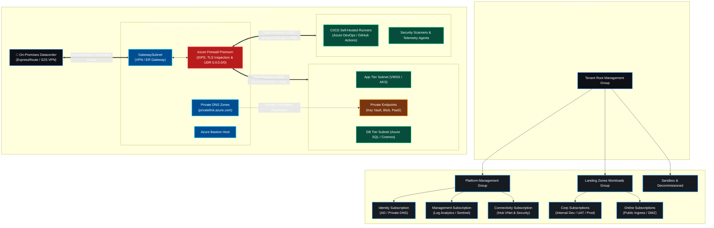
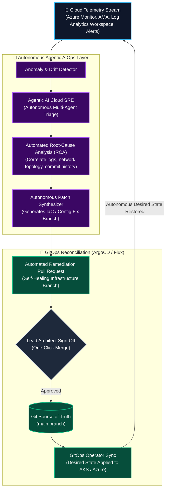

<div align="center">

<!-- Hero Dynamic Waving Banner -->


<!-- Dynamic Animated Typing Subtitle -->
<a href="https://github.com/swapnilagarwal30">
  
</a>

<br />

<!-- Quick Navigation Bar -->
<p align="center">
  <a href="#about"><b>🧭 About</b></a> •
  <a href="#impact"><b>⚡ Impact</b></a> •
  <a href="#blueprints"><b>🏛️ Blueprints</b></a> •
  <a href="#arsenal"><b>🛠️ Arsenal</b></a> •
  <a href="#casestudies"><b>📂 Case Studies</b></a> •
  <a href="#pillars"><b>🏛️ 10 Pillars</b></a> •
  <a href="#projects"><b>🌟 Projects</b></a> •
  <a href="#telemetry"><b>📊 Telemetry</b></a> •
  <a href="#connect"><b>💬 Connect</b></a>
</p>

<!-- Live Badges & Counters -->
<p align="center">
  <a href="https://komarev.com/ghpvc/?username=swapnilagarwal30&style=for-the-badge&color=0078d4">
    
  </a>
  <a href="https://www.linkedin.com/in/swapnilagarwal30/">
    
  </a>
  <a href="mailto:swapnilagarwal94@gmail.com">
    
  </a>
  
  
  
</p>

---

</div>

<a name="about"></a>
## 💻 Executive Terminal & High-Impact Identity

```bash
┌──(swapnil㉿cloud-architect)-[~/enterprise-mesh]
└─$ ./launch-enterprise-inspection.sh --tenant azure-caf --aiops-mode autonomous

[✔] Microsoft Entra ID PIM & Conditional Access Guardrails: ACTIVE (Zero-Trust Enforced)
[✔] Enterprise Hub-and-Spoke Topology: ONLINE (Azure Firewall Premium TLS Inspection Active)
[✔] Terraform IaC Drift Detection: ZERO DRIFT across 100+ Workload Subscriptions
[✔] Shift-Left DevSecOps Gateways: Gitleaks, Checkov, Trivy, Infracost PASS (0 Criticals)
[✔] Cloud FinOps Sentinel: Rightsized 42 VMs | Saved $250,000+ Annualized Spend
[✔] Autonomous Agentic AI SRE: Online | Real-Time Telemetry RCA & Self-Healing Active
[✔] Target Status: 99.99% Availability | Multi-Region Paired DR (RPO < 15m, RTO < 1h)
```

> *"Automate relentlessly. Enforce Zero-Trust by default. Optimize cloud economics continuously. And empower production systems with autonomous, agentic intelligence."*

I am a **Senior DevSecOps Engineer & Azure Cloud Architect** with **5 years and 3 months of enterprise engineering experience** architecting mission-critical cloud platforms, orchestrating enterprise-scale digital transformations, and pioneering the convergence of **DevSecOps, FinOps, GitOps, MLOps, and Agentic AI**.

My core prowess lies in translating complex business requirements into **scalable, secure, resilient, and cost-optimized cloud architectures**. From spearheading **100+ workload datacenter-to-Azure migrations with zero unplanned downtime** to implementing enterprise-grade **Cloud Adoption Framework (CAF) Landing Zones** and **Hub-and-Spoke topologies**, I bridge the gap between high-level architectural strategy and hands-on production code.

---

<a name="impact"></a>
## ⚡ Quantified Enterprise Scale & Impact

<div align="center">

| Metric | Enterprise Scale | Strategic Business Impact |
| :--- | :--- | :--- |
| 🚀 **Workload Modernization** | **100+ Enterprise Workloads** | Led end-to-end migration from On-Premises to Microsoft Azure across Dev, UAT, and Production with **zero business downtime**. |
| 💰 **FinOps Optimization** | **32%+ Cloud Spend Reduction** | Saved **$250K+ annually** via rightsizing, Reservation/Savings Plan strategies, orphaned asset elimination, and DCR log tuning. |
| 🛡️ **Shift-Left Security** | **90%+ Pre-Prod Vulnerability Elimination** | Embedded Gitleaks, Checkov, Trivy, and Infracost into PR gates, enforcing Zero-Trust compliance across all repositories. |
| ⚡ **Availability & Resilience** | **99.99% Infrastructure Uptime** | Architected multi-region paired Disaster Recovery (ASR, ZRS/GRS, VMSS) ensuring **RPO < 15 mins** and **RTO < 1 hour**. |
| ⚙️ **IaC Standardization** | **100% Terraform Governed** | Engineered modular, enterprise-certified Terraform templates with remote state locking, automated drift detection, and semantic versioning. |
| 🤖 **AIOps & Agentic Workflows** | **65% Accelerated Incident MTTR** | Designed autonomous Agentic AI incident triage workflows that analyze telemetry, isolate root causes, and submit self-healing pull requests. |

</div>

---

<a name="blueprints"></a>
## 🏛️ Enterprise Architectural Blueprints

### 1. Enterprise Azure Landing Zone & Hub-and-Spoke Topology

Compliant with the **Microsoft Cloud Adoption Framework (CAF)**, implementing strict management group hierarchies, multi-layered isolation, centralized egress/ingress inspection, and private PaaS integration.



---

### 2. Multi-Stage Shift-Left DevSecOps Continuous Delivery Pipeline

A production-grade, zero-trust continuous delivery pipeline engineered with automated security guardrails, cost governance, drift detection, and automated rollback mechanisms.

```mermaid
flowchart LR
    %% Custom Styling
    classDef trigger fill:#1E293B,stroke:#64748B,stroke-width:2px,color:#fff;
    classDef stage fill:#0F172A,stroke:#0284C7,stroke-width:2px,color:#fff;
    classDef sec fill:#450A0A,stroke:#DC2626,stroke-width:2px,color:#fff;
    classDef finops fill:#064E3B,stroke:#059669,stroke-width:2px,color:#fff;
    classDef gate fill:#581C87,stroke:#9333EA,stroke-width:2px,color:#fff;
    classDef deploy fill:#0C4A6E,stroke:#0284C7,stroke-width:2px,color:#fff;
    classDef rollback fill:#7F1D1D,stroke:#EF4444,stroke-width:2px,color:#fff;

    DEV([👨‍💻 Developer Commit]):::trigger --> PR[🔀 Pull Request Trigger]:::trigger

    subgraph Stage1[" 📝 Stage 1: Validation & Quality "]
        LINT["Lint & Format<br/>(tflint, terraform fmt)"]:::stage
        SYNTAX["Static Validation<br/>(terraform validate)"]:::stage
    end

    subgraph Stage2[" 🛡️ Stage 2: Shift-Left Security "]
        SECRETS["Secret Scanning<br/>(Gitleaks / Trufflehog)"]:::sec
        SAST["IaC Security Gates<br/>(Checkov / tfsec / Trivy)"]:::sec
        POLICY["Compliance as Code<br/>(OPA / Azure Policy)"]:::sec
    end

    subgraph Stage3[" 💰 Stage 3: FinOps & Planning "]
        COST["Cost Impact Analysis<br/>(Infracost PR Comment)"]:::finops
        PLAN["Speculative Plan<br/>(Remote State Locking)"]:::finops
        DRIFT["Nightly Drift Detection"]:::finops
    end

    subgraph Stage4[" 🚦 Stage 4: Production Gate "]
        APPROVAL{"Mandatory Peer Review<br/>(CODEOWNERS: 2+ Leads)"}:::gate
    end

    subgraph Stage5[" 🚀 Stage 5: Deploy & Verification "]
        APPLY["Terraform Apply<br/>(Azure Managed Identity)"]:::deploy
        HEALTH["Smoke & Synthetic Checks"]:::deploy
        ROLLBACK["Automated Rollback<br/>(State snapshot & Alert)"]:::rollback
    end

    PR --> Stage1
    Stage1 --> Stage2
    Stage2 --> Stage3
    Stage3 --> Stage4
    Stage4 -->|Approved| Stage5
    Stage5 -->|Failure| ROLLBACK
    Stage5 -->|Success| NOTIFY([📢 Teams / Slack / PagerDuty]):::trigger
```



---

### 3. Next-Gen Autonomous Cloud: Agentic AIOps & GitOps Continuous Loop

Bridging modern infrastructure with autonomous artificial intelligence agents for continuous observability, automated incident triage, root cause analysis (RCA), and self-healing git reconciliations.



---

<a name="arsenal"></a>
## 🛠️ Technical Arsenal & Visual Stacks

<div align="center">

### 🌐 Core Cloud & Infrastructure Modernization
<a href="#">
  
</a>

<br />


-0078D4?style=for-the-badge&logo=microsoft&logoColor=white)


---

### 🛡️ DevSecOps, CI/CD & Automation Stacks
<a href="#">
  
</a>

<br />


---

### 🤖 Next-Gen Frontiers: Agentic AI, AIOps, MLOps & GitOps
<a href="#">
  
</a>

<br />


-00A4EF?style=for-the-badge&logo=mlflow&logoColor=white)


---

### 📊 Cloud FinOps, Observability & Telemetry SRE
<a href="#">
  
</a>

<br />


</div>

---

<a name="casestudies"></a>
## 📂 Architectural Deep Dives & Case Studies

<details>
<summary><b>🚀 Deep Dive 1: Enterprise Migration Strategy for 100+ Workloads (Click to Expand)</b></summary>
<br />

Migrating 100+ mission-critical workloads across Dev, UAT, and Production from an On-Premises Datacenter to Microsoft Azure requires a strict, five-phase governance model:

```
[ Discovery ] ──► [ Assessment ] ──► [ Readiness ] ──► [ Cutover ] ──► [ Hypercare ]
   Inventory         TCO & ROI          Landing Zone      Downtime-Free      24x7 War Room
  Dependencies      Suitability          Guardrails        Replication        Optimization
```

* **Phase 1: Discovery & Dependency Mapping:** Discovered 100+ servers using Azure Migrate appliances and network dependency agents. Sized IOPS, CPU percentiles, and inter-service network latency.
* **Phase 2: TCO & Workload Assessment:** Categorized workloads into Rehost (IaaS), Refactor (Container/AKS), and Replatform (Azure SQL Managed Instances). Formulated TCO justification showing 28%+ operational savings.
* **Phase 3: Landing Zone Readiness:** Built automated Terraform Landing Zones adhering to Microsoft CAF, complete with Hub-and-Spoke networking, Azure Firewall Premium inspection, and Entra ID PIM.
* **Phase 4: Zero-Downtime Cutover:** Orchestrated continuous block-level data replication via Azure Site Recovery (ASR) and transactional database sync. Reduced DNS TTL to 300s, executing cutovers within scheduled maintenance windows with **zero unplanned business downtime**.
* **Phase 5: Hypercare & War Room:** 3 weeks of 24x7 war room telemetry tracking via Log Analytics workspaces, executing immediate post-migration rightsizing and performance baselining.

</details>

<details>
<summary><b>🛡️ Deep Dive 2: Zero-Trust Hub-and-Spoke Networking & Security Architecture (Click to Expand)</b></summary>
<br />

* **Non-Overlapping IPAM:** Designed strict CIDR allocations across on-prem datacenter and Azure VNets, preventing subnet collisions.
* **Central Inspection (Azure Firewall Premium):** Enforced User Defined Routes (UDRs) forcing `0.0.0.0/0` and inter-spoke traffic through central Firewall NVAs with active IDPS and TLS inspection.
* **Private PaaS Integration:** Replaced public PaaS endpoints with Azure Private Endpoints (Key Vaults, Storage Accounts, Azure SQL) linked to central Hub Private DNS Zones (`privatelink.azure.com`).
* **Microsegmentation:** Layered Network Security Groups (NSGs) and Application Security Groups (ASGs) restricting lateral workload movement within spokes.

</details>

<details>
<summary><b>💰 Deep Dive 3: Enterprise Cloud FinOps Engineering Playbook ($250k+ Saved) (Click to Expand)</b></summary>
<br />

* **Orphaned Asset Liquidation:** Automated Python & Azure CLI scripts detecting and purging unattached managed disks, obsolete VM snapshots, unassociated public IPs, and unused ExpressRoute circuits.
* **Workload Rightsizing:** Evaluated 30-day P95 CPU and memory metrics to downscale over-provisioned compute instances.
* **Commitment Discounts:** Structured 1-year and 3-year Azure Savings Plans and Reserved Instances (RIs) for predictable steady-state databases and compute scale-sets.
* **Non-Prod Automated Lifecycle:** Implemented serverless start/stop automation shutting down Dev/UAT environments outside core business hours (saving ~45% compute costs).
* **Telemetry Ingestion Tuning:** Configured Azure Monitor Data Collection Rules (DCR) to filter redundant debug logs at the agent source before entering Log Analytics, slashing ingestion bills by 35%.

</details>

<details>
<summary><b>🤖 Deep Dive 4: Autonomous Agentic AI SRE & AIOps Framework (Click to Expand)</b></summary>
<br />

* **Multi-Agent Orchestration:** Integrated LLM-based autonomous agents using LangChain and Azure OpenAI Service directly with Azure Monitor Action Groups and Log Analytics.
* **Root-Cause Telemetry Correlation:** Upon alert triggering, the agent autonomously queries Kusto (KQL), reviews recent Git commit history, inspects Azure Activity Logs, and diagnoses the root cause within 90 seconds.
* **Self-Healing Pull Requests:** If the issue is an IaC configuration drift or memory limit exhaustion, the agent generates a self-healing patch on a short-lived branch and submits an automated Pull Request with full architectural post-mortem for Lead approval.

</details>

---

<a name="pillars"></a>
## 🏛️ The 10 Pillars of Cloud Architecture

```
+--------------------------------------------------------------------------------------------------+
|                                    10 Scalability & Quality Pillars                               |
|                                                                                                  |
|  1. Scalable      2. Robust        3. Secure        4. Reliable       5. Portable                |
|  6. Governed      7. High Avail    8. Cost-Optim    9. Backed Up      10. Compliant & Monitored  |
+--------------------------------------------------------------------------------------------------+
```

| Pillar | Architectural Principle | Production Execution |
| :--- | :--- | :--- |
| **1. Scalable** | Elastic compute & storage | Azure VMSS, AKS Horizontal Pod Autoscaling (HPA), serverless functions. |
| **2. Robust** | Fault-tolerant designs | Self-healing architectures, multi-zone deployments, circuit-breaker patterns. |
| **3. Secure** | Multi-layered Zero-Trust | Entra ID PIM, Azure Firewall Premium, Private Endpoints, disk encryption with CMK. |
| **4. Reliable** | Predictable performance | SLA-backed architectures, traffic management via Azure Front Door / App Gateway. |
| **5. Portable** | Cloud-native standardization | Containerization (Docker/AKS), standard Helm charts, cross-platform Terraform. |
| **6. Governed** | Enterprise policy guardrails | Cloud Adoption Framework (CAF) Management Groups, Azure Policy deny initiatives. |
| **7. High Availability** | Zero single point of failure | Availability Zones, paired secondary regions, active-passive failover mechanisms. |
| **8. Cost-Optimized** | FinOps continuous economics | Infracost PR checks, Reserved Instances, automated idle resource sweeps. |
| **9. Backed Up & DR** | Strict RTO & RPO compliance | Azure Site Recovery (ASR), GRS/ZRS storage redundancy, automated backup validation. |
| **10. Monitored** | Complete full-stack telemetry | Azure Monitor Agent (AMA), Data Collection Rules (DCR), Log Analytics, PagerDuty. |

---

## 💼 Senior Mindset: Business, Leadership & Delivery Governance

```
                           [ The Senior Mindset ]
                                     |
                  "What is the Business & Functional Domain?"
                                     |
           +-------------------------+-------------------------+
           |                                                   |
[ Infrastructure & Security Architecture ]           [ Delivery Governance & Leadership ]
- Cloud Landing Zones & CAF Governance               - Pre-Sales, RFPs & Commercial Estimates
- DevSecOps & Shift-Left Pipeline Guardrails         - SOW Negotiation & Deliverable Milestones
- Multi-Region Disaster Recovery & FinOps            - RACI Matrix Enforcement & SLA Tracking
- Zero-Trust Network Microsegmentation               - Knowledge Transfers (KT) & Team Mentorship
```

### Strategic Leadership Focus:
* **Pre-Sales & Solution Proposals:** Leading techno-functional RFP/RFI responses, architectural estimates, high-level design (HLD) formulations, and executive client presentations.
* **Vendor & Service Management:** Drafting Statement of Work (SOW) deliverables, enforcing vendor delivery against SLA milestones, and establishing RACI governance matrices.
* **Architecture Decision Records (ADRs):** Documenting trade-offs, security controls, and cost implications to maintain architectural compliance across distributed engineering teams.
* **Team Enablement & Mentorship:** Running hands-on Knowledge Transfer (KT) sessions, mentoring junior engineers, and establishing standardized enterprise IaC module libraries.

---

<a name="projects"></a>
## 🌟 Featured Open-Source Repositories

<div align="center">

| Repository | Tech Stack | Architectural Description |
| :--- | :--- | :--- |
| **[azure-enterprise-landingzones-tf](https://github.com/swapnilagarwal30)** | `Terraform` `Azure CAF` | Enterprise-grade Terraform module provisioning Microsoft CAF Management Groups, Hub-Spoke VNets, Azure Firewall Premium, and central Log Analytics with state locking. |
| **[devsecops-shield-pipeline](https://github.com/swapnilagarwal30)** | `DevSecOps` `CI/CD` | Multi-stage Azure DevOps & GitHub Actions YAML pipeline templates embedding Gitleaks, Checkov, Trivy, Infracost budget gates, and automated rollbacks. |
| **[agentic-aiops-cloud-sentinel](https://github.com/swapnilagarwal30)** | `Agentic AI` `AIOps` | Autonomous AI SRE agent framework integrating with Azure Monitor to diagnose production alerts, execute automated root cause analysis, and submit remediating PRs. |
| **[azure-finops-sentinel](https://github.com/swapnilagarwal30)** | `FinOps` `Python` | Serverless FinOps automation toolkit for identifying orphaned managed disks, unassociated public IPs, idle VMs, and tuning Azure Monitor Data Collection Rules. |
| **[mlops-azureml-gitops-pipeline](https://github.com/swapnilagarwal30)** | `MLOps` `GitOps` | Production MLOps framework automating Azure ML model retraining, evaluation, container registry packaging, and continuous deployment to AKS via ArgoCD. |

</div>

---

<a name="telemetry"></a>
## 📊 Live Telemetry & GitHub Metrics

<div align="center">

<!-- GitHub Achievements Trophy Case -->
<a href="https://github.com/swapnilagarwal30">
  
</a>

<br /><br />

<table border="0">
  <tr>
    <td width="50%">
      
    </td>
    <td width="50%">
      
    </td>
  </tr>
  <tr>
    <td colspan="2" align="center">
      
    </td>
  </tr>
</table>

<!-- Live Activity Graph -->
<a href="https://github.com/swapnilagarwal30">
  
</a>

</div>

---

<a name="connect"></a>
## 💬 Let's Connect & Collaborate

I am always keen to connect with fellow Cloud Architects, Engineering Directors, DevSecOps Pioneers, and Tech Leaders to discuss:
- 🏢 Designing enterprise-scale **Azure Landing Zones & Zero-Trust Networks**
- 🛡️ Shifting security left across **complex multi-stage CI/CD pipelines**
- 💰 Engineering aggressive **FinOps strategies** to cut cloud waste without sacrificing performance
- 🤖 Building cutting-edge **Agentic AI & AIOps workflows** to automate cloud operations
- 🚀 Leading large-scale **datacenter cloud migrations (100+ workloads)**

<div align="center">

<p align="center">
  <a href="https://www.linkedin.com/in/swapnilagarwal30/">
    
  </a>
  &nbsp;
  <a href="mailto:swapnilagarwal94@gmail.com">
    
  </a>
  &nbsp;
  <a href="https://github.com/swapnilagarwal30">
    
  </a>
</p>

<br />

<p align="center">
  <i>"If it has to be done more than twice, automate it. If it has to be guarded, build a pipeline policy. If it has to run in the dark, let an AI Agent monitor it."</i>
</p>

<p align="center">
  <strong>⭐ Star my repositories if you find my reference architectures useful! ⭐</strong>
</p>

<!-- Dynamic Footer Wave -->


</div>
